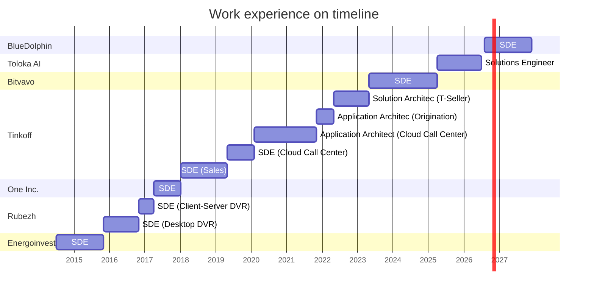

# Vladislav Ramazaev | Staff Software Engineer & Architect | AI, Backend & Distributed Systems | 10+ Years of Experience

| Current location | Email | LinkedIn | Telegram | GitHub | Links |
| --- | --- | --- | --- | --- | --- |
| The Netherlands | [vl.ramazaev@gmail.com](vl.ramazaev@gmail.com) | [@vladar107](https://www.linkedin.com/in/vladar107/?locale=en_US) | [@vladar107](https://t.me/vladar107) | [@vladar107](https://github.com/vladar107) | [All Links](https://linktr.ee/vladar107)

[Mentor](https://openmentor.io/mentor/vladar107) and [Blog](https://t.me/techlead_Insights) author.

Interested in **Software Architecture**, **AI-assisted Development**, **Technical Leadership**, and **Developer Productivity**.

Software Engineer and Architect with 10+ years of experience building backend and distributed systems across fintech, trading, AI, and enterprise software. My experience spans hands-on development, application architecture, technical leadership, client-facing solution design, and mentoring.

I focus on designing scalable and maintainable systems, improving engineering processes, and translating complex business requirements into practical technical solutions. More recently, I have been exploring how AI agents, context engineering, and shared engineering knowledge can improve software development workflows.

## Key Skills

| Architecture & Leadership | Languages               | Data & Messaging | Infrastructure | AI                      |
| ------------------------- | ----------------------- | ---------------- | -------------- | ----------------------- |
| Software Architecture     | C# / .NET               | PostgreSQL / SQL | AWS            | AI-assisted Development |
| Solutions Architecture    | Kotlin                  | ClickHouse       | Azure          | Coding Agents           |
| Technical Leadership      | TypeScript / JavaScript | MongoDB          | Docker         | Agentic Workflows       |
| System Design             | Python                  | DuckDB           | Kubernetes     | Context Engineering     |
| Distributed Systems       |                         | Kafka            | CI/CD          | MCP                     |
| Technical Discovery       |                         | RabbitMQ         | GitOps         | LLM Evaluation          |
|                           |                         | Redis            | Cloudflare     | Prompt / Skill Design   |

## Experience

### [BlueDolphin](https://bluedolphin.io/) | Software Development Engineer | Utrecht, Netherlands | 08.2026 - Present
A SaaS platform for enterprise architecture and business process design.
- Introduced AI-assisted development practices across the company by establishing shared agent instructions and a reusable skill catalogue
- Made a key configuration workflow ~35x faster for large customers, reducing processing time from over an hour to under 2 minutes through bulk updates and background processing

<u>_Technologies_</u>: C#, .NET 10, ASP.Net Core, MongoDB, Azure SQL Server, Redis, Azure Service Bus, Docker, k8s, Azure, Azure DevOps, GitHub Actions, Claude Code.

### [Toloka AI](https://toloka.ai/) | Solutions Engineer | Amsterdam, Netherlands | 05.2025 - 07.2026
Client-facing role delivering AI data and evaluation solutions for large-scale projects with leading AI companies.
- Led end-to-end delivery of LLM evaluation datasets, from requirements discovery and solution design to implementation, quality assurance, and final delivery
- Designed scalable data production and evaluation pipelines for complex model evaluation and red-teaming projects
- Introduced LLM-powered auto-checks and automated quality gates, reducing manual validation effort by approximately 70%
- Built agent-based workflows and automated execution pipelines, reducing item processing time from around one week to two days
- Served as a primary technical point of contact for clients, translating evolving requirements into executable technical solutions and coordinating delivery across engineering and operations teams

<u>_Technologies_</u>: Python, Temporal, GitHub Actions, Databricks, Claude Code, Claude Skills, Agentic Flows.

### [Bitvavo](https://bitvavo.com/en) | Software Development Engineer | Amsterdam, Netherlands | 06.2023 - 04.2025
Worked as part of the trading team at a cryptocurrency exchange, building systems for market making, hedging, and other trading operations.
- Designed and implemented trading solutions and strategies supporting P&L growth
- Designed and built two backend services, reducing peak processing latency from 4 hours to 5 minutes
- Owned part of the MiCA regulatory migration, driving architecture and implementation changes across trading systems to meet new EU regulatory requirements

<u>_Technologies_</u>: Kotlin, TypeScript, MySQL, Kafka, Docker, k8s, AWS, GitHub Actions, Terraform.

### [Tinkoff](https://www.tinkoff.ru) | Solution Architect (Staff Engineer) | Yerevan, Armenia | 01.2018 – 05.2023
Tinkoff is one of Russia’s leading digital banking and fintech companies([more information](https://www.tinkoff-group.com/company-info/summary/)), comparable in product scope to companies such as Revolut.

In addition to my project responsibilities, I contributed to several engineering-wide initiatives:
- Hiring and technical interviews
- Mentoring, including coordination of the mentoring process across the .NET engineering stream
- Engineering education as a lecturer for public courses
- The internal .NET community as an active contributor

#### **[Tinkoff Seller](https://www.tinkoff.ru/business/seller/)** | Solution Architect (Staff Engineer) | 05.2022 - 05.2023
Designed, built, and launched Tinkoff Seller, a marketplace aggregation platform for merchants.
- Defined and drove the technical roadmap
- Established the development process across 3 newly formed teams
- Mentored 3 engineers, all of whom were later promoted

<u>_Technologies_</u>: C#, TypeScript, .Net 6, ASP.Net Core, Angular 14, PostgreSQL, Kafka, Docker, k8s, Gitlab CI.

<u>_Approaches_</u>: ADR, RFC, Shift Left Testing, Technology Roadmap, TBD, 12 factors, Cloud Native.

#### **Tinkoff Business. New Partners origination** | Application Architect (Staff Engineer) | 12.2021 - 05.2022
Developed and launched a BNPL platform for business users from scratch, helping reduce application processing time from 3 weeks to 2 days.
- Established the development process for a newly formed team
- Mentored engineers across teams, contributing to 1 promotion

<u>_Technologies_</u>: C#, TypeScript, .Net 6, ASP.Net Core, Angular 14, PostgreSQL, Kafka, Docker, k8s, Gitlab CI.

<u>_Approaches_</u>: ADR, Shift Left Testing, TBD, 12 factors, Cloud Native.

#### **Tinkoff Business. Cloud Call Center** | Software Development Engineer/Application Architect | 05.2019 - 11.2021
Joined the Cloud Call Center product as a Software Engineer and later transitioned into an Application Architect role, taking broader responsibility for the system's architecture and technical evolution.
- Improved product scalability, flexibility, and availability, achieving 99.99% uptime
- Reduced client integration time from 1 month to 3 days by launching a universal public API
- Increased flow efficiency by 30% and cut lead time by 2 weeks
- Led a .Net platform course for interns and mentored colleagues, resulting in 3 promotions

<u>_Technologies_</u>: C#, TypeScript, .Net 5, ASP.Net Core, Angular 12, MongoDB, Kafka, Rabbit MQ, gRPC, Docker, k8s, Gitlab CI, Teamcity.

#### **Calling Sales System** | Software Development Engineer | 01.2018 - 05.2019
Developed a call-based sales system from scratch for selling a specific product. The solution consisted of multiple services supporting the end-to-end sales process. After the initial development phase, I was responsible for production releases and early-stage maintenance

<u>_Technologies_</u>: C#, TypeScript, .Net Core 2.1, ASP.Net Core, Angular 8, MongoDB, Rabbit MQ, Docker, Teamcity.

### [One inc.](https://www.oneinc.com/) | Software Development Engineer | St.Petersburg, Russia | 04.2017 – 01.2018
Contributed to the full-stack development of a vehicle insurance application covering the complete insurance policy lifecycle. Worked across both backend and frontend parts of the product, contributing to the evolution of the existing architecture and overall code quality.

<u>_Technologies_</u>: C#, TypeScript, .Net Framework 4.0, .Net Core 1.0, ASP.Net Core, MS SQL Server, Angular 2, Silverlight.

### [Rubezh](https://rubezh.com/) | Software Development Engineer | Saratov, Russia | 11.2015 - 04.2017
Contributed to the development of two software products for video surveillance systems: a standalone desktop application and a client-server solution.

<u>_Technologies_</u>: C#, XAML, C, C++, .Net Framework 4.0, WPF, WinForms, WCF, MySQL, FireBird, IP cameras, ffmpeg.

### [Energoinvest](http://www.energoin.ru/) | Software Development Engineer/Ops | Saratov, Russia | 07.2014 - 11.2015
Contributed to the development of a platform for an energy supplier. Maintained and extended an existing Delphi-based application, implemented new functionality, and worked on database design and schema changes.

<u>_Technologies_</u>: C#, Delphi, .Net Framework 4.5, WinForms, MS SQL Server.

## Projects

### [ClaudeScope](https://github.com/vladar107/claudescope)
Open-source tool for inspecting and analyzing coding-agent sessions, with a focus on context management, memory, and agent behavior.
- Built a session inspection workflow that makes agent context, tool usage, and stored information easier to explore.
- Added support for analyzing how coding-agent harnesses persist and retrieve information across sessions.
- Used the project as a practical foundation for research and talks about coding-agent context and memory.

<u>_Technologies_</u>: TypeScript, Node.js, React, Fastify, DuckDB, MCP, Vite

## Education
### [Saratov State University](https://en.sgu.ru/) | Saratov, Russia | 09.2015 - 10.2016
Master’s program in Computer Science – completed 1 year of a 2-year program.

### [Saratov State University](https://en.sgu.ru/) | Saratov, Russia | 09.2011 - 06.2015
Bachelor's degree in Computer Science.

<u>_GPA_</u>: 3.8/4.0
